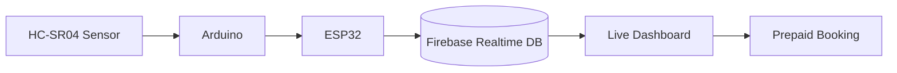
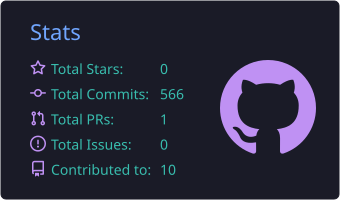
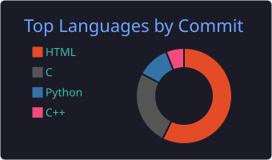

<div align="center">


[**Live Demo**](https://atul-singh-07.github.io) &nbsp;·&nbsp; [**Smart Parking**](https://atul-singh-07.github.io/Smart-Parking-Dashboard) &nbsp;·&nbsp; [**LinkedIn**](https://linkedin.com/in/atul-singh-o7)

</div>

---

## `SYSTEM IDENTIFICATION`

```yaml
NAME         : Atul Singh
ROLE         : ECE Student · Embedded Systems · IoT Developer
UNIVERSITY   : Gurugram University — B.Tech ECE
LOCATION     : Gurugram, India
STATUS       : Learning & Building
FLAGSHIP     : AtulOS v2.2 — Browser-Based OS Simulation
OPEN TO      : Internships · Hackathons · Open-source collabs
```

---

## `CURRENT MODULES`

```
Embedded Systems & Arduino     [■■■■■■■■░░]  80%
ESP32 + IoT + Firebase         [■■■■■■■░░░]  70%
Python OOP + Libraries         [■■■■■■░░░░]  60%
C++ Object Oriented            [■■■■░░░░░░]  40%
ROS 2 + Robotics               [■■■░░░░░░░]  30%
```

---

## `NOW`

```
BUILDING   : AtulOS — new modules and AtulAI upgrades
LEARNING   : ROS 2 · C++ OOP · MQTT at scale
NEXT       : Take Smart Parking from prototype to a deployable system
```

---

## `TECH STACK`

### ⚙️ Embedded & Hardware


### ☁️ IoT & Cloud


### 🤖 Robotics


### 💻 Programming


### 🛠️ Tools


---

## `DEPLOYED SYSTEMS`

### 🖥️ AtulOS — Browser-Based OS Simulation &nbsp; 

> A fully functional browser OS with AI engine, voice control,
> IoT device management, and real-time Firebase connectivity.

```
FEATURES  : AtulAI Engine v2.2 · Voice I/O · Wake Word
            Smart Parking · EV Charging · Auth Terminal
            System Monitor · Friend Profiles · Calculator
STACK     : HTML · CSS · JavaScript · Firebase · IoT
BUILD     : v2.2 Stable
```
🔗 [Live Demo](https://atul-singh-07.github.io)

<!-- TIP: drop a screenshot or a short GIF here, e.g.
 -->

---

### 🅿️ Smart Parking Management System &nbsp; 

> Real-time IoT parking with ultrasonic detection,
> Firebase cloud sync and prepaid booking dashboard.

```
HARDWARE  : Arduino + ESP32 + HC-SR04
CLOUD     : Firebase Realtime Database
FRONTEND  : Live HTML Dashboard
```



🔗 [Live Dashboard](https://atul-singh-07.github.io/Smart-Parking-Dashboard) &nbsp;|&nbsp; [GitHub](https://github.com/atul-singh-07/Smart-Parking-Dashboard)

---

### ⚡ Arduino Projects Collection

> Hands-on embedded builds — sensors, motors, displays, communication

```
01 · LED Blink                   05 · Seven Segment Display
02 · Traffic Light System        06 · Servo Motor Control
03 · DHT11 Temp & Humidity       07 · Ultrasonic Radar System
04 · RGB LED Control             08 · Joystick Controlled LED
```
🔗 [View All](https://github.com/atul-singh-07/arduino-projects)

---

## `GITHUB STATS`

<div align="center">





</div>

---

## `CONTRIBUTION SNAKE`

<div align="center">

<picture>
  <source media="(prefers-color-scheme: dark)" srcset="https://raw.githubusercontent.com/atul-singh-07/atul-singh-07/output/github-snake-dark.svg" />
  
</picture>

</div>

---

## `CONNECT`

<div align="center">

[](https://linkedin.com/in/atul-singh-o7)
[](https://atul-singh-07.github.io)
[](https://github.com/atul-singh-07)


</div>

---

<div align="center">
<sub>Built with 🔌 hardware and ☁️ cloud · AtulOS v2.2</sub>
</div>
